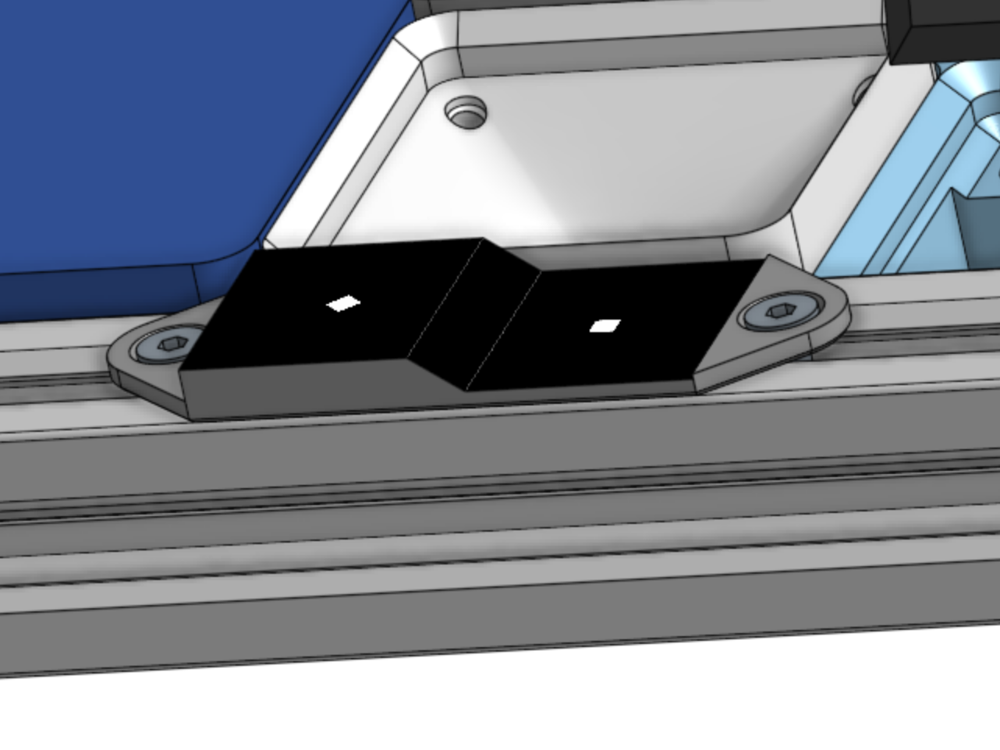

# PnP first-time calibration

From a freshly assembled machine to a usable pick frame in few steps.

Related: [PnP Vision](PnP_Vision.md), [move transform](PnP_Move_Transform.md),
[G-Codes](G-Codes.md#pnp_vision).

Each `PNP_CALIB_*` opens a typical for klipper **wizard**. Like `MANUAL_PROBE` or `BED_SCREWS_ADJUST`. Typically registers 3 commands: **`SAMPLE` / `DONE` / `ABORT`** for its lifetime. One wizard at a time. There is no `ACCEPT` like in klipper, we use `DONE`.

There is no `SAVE_CONFIG` you need to **copy/paste sections of output into config yourself**. This way you can retain control over layout of your config files - includes etc.
Most of results inject themselves into "running config" so you can see results of your calibration live. You can just restart machine to discard them.

`PNP_CALIB_PXMM` and `PNP_VISION_RUNOUT` operate on relative motion, you don't need to be homed to run those and get good results.

## Homing Block

Homing block we use on our machine (and snippets refer to) is similar to what OpenPNP uses, but instead of round fiducials we use square with secondary rotated 45deg (diamond) - this way you can differentiate between them in detection pipeline.
Also we use a 3-4-5mm triangle ramp between fiducial levels, which allows both of them to be printed on single sticker and glued on in one go. See pic:



## Pipelines we use for calibration

Here's a list of pipelines we uso on our machine, You can put then is 'startup' `[delayed_gcode]` "macro".

```ini
[delayed_gcode startup]
initial_duration: 0.1
gcode:
    PNP_VISION_PIPELINE NAME=visual_home LIGHT=1 PARAMS="thresh:64;min_area:20.;max_area:400000.;min_w_px:5;max_w_px:1000;min_aspect:0.8;max_aspect:1.2;rot:0.0;rot_tol:90." STEPS="blurgausian(5)|gray()|threshold(thresh,255)|morph_open(5,2)|find_contours_ex(min_area,max_area)|make_rects()|filter_rects_aspect(min_aspect,max_aspect)|filter_rects_width(min_w_px,max_w_px)|filter_square_rot(rot,rot_tol)|color()|draw_rects()"
    PNP_VISION_PIPELINE NAME=runout           LIGHT=0.25 PARAMS="symmetry:0.8;min_r:5.;max_r:100.;thresh:127;mask_r:200."    STEPS="blurgausian(5)|mask_circ(cx,cy,mask_r)|gray()|threshold(thresh,255)|morph_close(5,2)|erode(5)|find_contours_by_r(min_r,max_r)|circularity(symmetry)|color()|draw_circles()"
    PNP_VISION_PIPELINE NAME=btmcalib   LIGHT=0.1 PARAMS="symmetry:0.7;min_r:1.;max_r:100;mask_r:200."    STEPS="blurgausian(3)|gray()|mask_circ(cx,cy,mask_r)|threshgaus(99,3)|morph_close(5,2)|morph_open(5,2)|find_contours_by_r(min_r,max_r)|circularity(symmetry)|pick_nearest(cx,cy)|color()|draw_circles()|list_circles()"
```

## Overall view

Here's brief list of steps:

- Zero Z axes and get Z heights of fiducials (so camera have reference planes)
- Top Camera Preliminary MMPX, so scaling and mask positioning can work in pipelines
- Top Camera CALIBRATION, to get undistorted view.
- Final MMPX for Top Camera, that takes to account calibration matrices.
- Now you can `HOME` and do `PNP_VISION_HOME`.
- Bottom Camera Preliminary MMPX, as above but also for preliminary runout for one of tools (use Z levels of fiducials for this if possible)
- Preliminary Runout, on one of tools (use z level of fiducial for this if possible)
- Tool offset - touch fiducial with nozzle tip. (need to be precise for just one (one you did runout of), rough on rest is fine)
- If you are restarting from here run MMPX and RUNOUT here for Z range you will be normally operating within and use that range in following steps too.
- Bottom Camera CALIBRATION, using "good" nozzle from previous step.
- Final MMPX for Bottom Camera, using same nozzle.
- Rerun Runout on new MMPX
- Bottom Camera and tools ALIGNMENT. Don't forget to run runout on other tools before sampling. Use biggest Z range for tools you can.

Have some rough guesses about your tool offsets in configuration file (i.e. based on your CAD) before you start. this will save you some jogging.

---

## 1. Balance Peter’s Head and seed fiducials

Jog **each** nozzle onto the primary (home) fiducial and note contact
gcode Z. Average → fiducial Z. Difference vs left →
`[stepper_z] position_endstop` so park is balanced. Restart, `HOME_Z` (`G28 Z`),
verify both sides.

Confirm with the secondary fiducial’s Z (nozzle contact).

With the topcam, jog over both marks and put their **rough** XY positions with respective Z
into `[pnp]`:

```ini
[pnp]
#...
fiducial_primary: {'x': 214.66, 'y': 384.16, 'z': -12.4, 'w': 2.0, 'h': 2.0, 'rot': 0.0, 'rot_tol': 10.0}
fiducial_secondary: {'x': 235.40, 'y': 384.25, 'z': -9.4, 'w': 2.0, 'h': 2.0, 'rot': 45.0, 'rot_tol': 10.0}
```

Save config, restart, `HOME`.

## 2. Topcam — Preliminary MMPX

Run `PNP_CALIB_PXMM` with small `STEP=` to stay within lowest distortion area and inside mask if you are using it in your pipeline.
`N=` param sets "mode": `4` (default) is simpler just cardinal directions or `8` also with diagonals.

If you add `FIDUCIAL=` machine will jog to coordinates from config and use it's z level.
alternatively you can jog yourself use `SAMPLE Z=..`.
you can pass params like `min_area=` `max_area=` to tighten pipeline defaults before machine learns how to scale `w` and `h` from fiducial config, `thresh=` or `light=` to tune how contours are recognized, `rot=` to distinguish between fiducials or `tol=` to set allowance for distortion (for aspect and w_px).

Please note that in our examples (sample output snippets) top camera is rotated 90 deg which can be seen in both preliminary mmpx and in rectification_matrix.

```text
home
PNP_TOOL SET=topcam
PNP_CALIB_PXMM cam=topcam step=2 pipeline=visual_home
SAMPLE FIDUCIAL=primary tol=0.2  min_area=8000 max_area=10000
SAMPLE FIDUCIAL=secondary tol=0.3 rot=45 min_area=10000 max_area=12000
done
```

Output will look like this:

```text
// heights so far: 2  [-12.4, -9.4]
// Z=-12.4 optical dist≈35.842mm (fx·upp, fx=1600)
// Z=-9.4 optical dist≈32.023mm (fx·upp, fx=1600)
// camera_z=15.7581 (upp intercept)
// PXMM done heights=2
// Paste into [camera_v4l topcam] section of machine.cfg:
// camera_z: 15.7581
// px_per_mm: ((((-0.61203003, 44.787567), (44.476929, 1.072464)), -12.4), (((-0.8631897, 49.742676), (50.159714, 1.358139)), -9.4))
```

Results will be applied into camera after `DONE` an will remain until restart unless you copy them into config. (those are temporary so if you want to keep going don't have to.)

## 3. Topcam — undistort, precise fiducial XY

```txt
home
PNP_TOOL SET=topcam
PNP_CALIB_CAMERA CAM=topcam PIPELINE=visual_home SPEED=25 SETTLE=1 PSTEP=200
SAMPLE FIDUCIAL=primary  tol=0.5 rot-0.0 rot_tol=10.
SAMPLE FIDUCIAL=secondary tol=0.5 rot-45.0 rot_tol=10.
done
```

Sample result:

```txt
// K from ΔZ/Δ(mm/px): fx=fy=1600 c=(800.00,600.00)
// Brown k1,k2 with K held fixed, reproj rms=2.736px
// maps generated ok
// rectification_matrix: [[0.01857145130634308, -0.9998275637626648, 0.0], [0.9998275637626648, 0.01857145130634308, 0.0], [0.0, 0.0, 1.0]]
// camera_matrix: [[1600.0, 0.0, 800.0], [0.0, 1600.0, 600.0], [0.0, 0.0, 1.0]]
// virtual_camera_matrix: [[1533.0404052734375, 0.0, 766.5202026367188], [0.0, 1532.9833984375, 766.49169921875], [0.0, 0.0, 1.0]]
// dist_coeffs: [0.10991832613945007, -0.49027958512306213, 0.0, 0.0, 0.0]
// Paste to [pnp]:
// fiducial_primary: {'x': 214.6505011124595, 'y': 384.17901083672683, 'z': -12.4, 'w': 2.0, 'h': 2.0, 'rot': 0.0, 'rot_tol': 10.0, 'dia': None}
// fiducial_secondary: {'x': 235.36966071674846, 'y': 384.28493161477405, 'z': -9.4, 'w': 2.0, 'h': 2.0, 'rot': 45.0, 'rot_tol': 10.0, 'dia': None}
// CAMERA top done [camera_v4l topcam] groups=2
```

If the rough XY in cfg is not set, jog over the mark `g1x214.5y385.8z-11.7` (including Z that will be taken as optical plane - tools wont move if you have `PNP_TOOL SET=topcam`) and `SAMPLE FIDUCIAL=primary min_r= max_r=`; the session prints a `fiducial_primary: {x, y, z}`, `fiducial_secondary: {x, y, z}` or `unnamed mark: {x, y, z}` to paste.

**Paste:** `camera_matrix`, `dist_coeffs`,
`rectification_matrix`, `virtual_camera_matrix`, and the solved fiducial
XY. don't use `mm_per_px`, it's from pre-rectification view.
You may round primary; `PNP_VISION_HOME` will `SET_GCODE_OFFSET` the rest.
in that case you may rerun `PNP_CALIB_CAMERA`, sample just secondary `SAMPLE FIDUCIAL=secondary` gather new `fiducial_secondary: {x, y, z}` and `ABORT`.

## 4. Topcam - Final MMPX

Rerun `PNP_CALIB_PXMM` for new `mm_per_px` and `camera_z`.

```txt
PNP_CALIB_PXMM cam=topcam step=2 pipeline=visual_home
SAMPLE FIDUCIAL=primary tol=0.2
SAMPLE FIDUCIAL=secondary tol=0.3
done
```

```txt
// Z=-12.4 optical dist≈37.374mm (fx·upp, fx=1600)
// Z=-9.4 optical dist≈33.545mm (fx·upp, fx=1600)
// camera_z=16.8778 (upp intercept)
// PXMM done heights=2
// Paste into [camera_v4l topcam] section of machine.cfg:
// camera_z: 16.8778
// px_per_mm: ((((-42.5, -0.125), (0, 43.125)), -12.4), (((-47.750031, -0.30267334), (0.12498474, 47.644455)), -9.4))
```

## 5. Restart home and first vision_home

Restart, `HOME` and `PNP_VISION_HOME'

```txt
HOME
PNP_TOOL SET=topcam
PNP_VISION_HOME FIDUCIAL=primary CAM=topcam PIPELINE=visual_home
```

`FIDUCIAL=primary`, `CAM=topcam` `PIPELINE=visual_home` are defaults so can be skipped
 `PNP_VISION_HOME` without params will work just fine

 ```txt
// home on primary: nominal XY=(214.6505,384.1790) Z_plane=-12.4
// home[1/8]: px=(769.00,765.00) d_mm=(0.0582,0.0346) err=0.0677mm
// home[2/8]: px=(766.50,765.50) d_mm=(-0.0005,0.0230) err=0.0230mm
// converged: err=0.0230 <= TOLERANCE=0.05
// final residual: px=(766.00,765.50) d_mm=(-0.0123,0.0230) err=0.0261mm
// toolhead=(214.6505,384.1790) will now report as (214.6505,384.1790)
// SET_GCODE_OFFSET X=0.058246 Y=0.034590
// PNP_VISION_HOME done on primary err=0.0261mm
```

## 6. Bottomcam seed - preliminary mmpx + runout **before** tooloffset

Kissing a fiducial with a nozzle for TOOLOFFSET (in nex steps) without runout would fold that eccentricity into `offset_x/y`. We need runout first, then offset on the **tooltip**.

You do **not** need a full bottomcam pose yet. One mm/px plane at the
same height as fiducial you wanna use (higher one seems good choice) is enough to convert
runout pixels.

Jog the loaded tip over the hole by eye (`PNP_TOOL SET=left`, `G1 Z-9.4`).
Tune `PIPELINE=nozzle` with `min_r=` / `max_r=`.
We recommend using `CN140` - with it's outside diameter slightly over 2mm, covering 2mm square fiducial will leave tiny triangles at corners which can be quite easily eyeballed to look equal.

```txt
PNP_TIP LOAD=CN140
PNP_CALIB_PXMM CAM=bottomcam pipeline=runout step=1
SAMPLE Z=-9.4 min_r=20 mask_4=300
DONE
//[..]
// Z=-9.4 optical dist≈25.365mm (fx·upp, fx=1920)
// pinhole needs two SAMPLE heights (fx is a placeholder until CAMERA)
// PXMM done heights=1
// Paste into [camera_v4l bottomcam] section of machine.cfg:
// camera_z: 0.0000
// px_per_mm: ((((74.320959, 0.69049371), (0.79452947, 77.114083)), -9.4), (((74.320959, 0.69049371), (0.79452947, 77.114083)), -9.4))
```

That one-Z `mm_per_px` (second plane can wait). is now in memory we can run `PNP_VISION_RUNOUT` on the same z plane. then uses **current XY**.

```txt
PNP_VISION_RUNOUT CAM=bottomcam PIPELINE=runout Z=-9.4 tol=0.3
// [..]
// runout CN140: radius=0.7049 phase=108.0336 deg  center=(227.9102,351.9158)
```

(yes, it's really bad nozzletip)

Optional: paste the printed runout centre as rough `camera_xy`.

## 7. tool offset

`PNP_CALIB_TOOLOFFSET` is not a wizard, it's a simple command.

We run this step on secondary fiducial which is higher and its Z plane gives better pose in bottom camera view.

If you have some rough offsets already in config you can `PNP_TOOL SET=TOPCAM` and `pnp_vision_home fiducial=secondary set_offset=0` to go to fiducial location, then change tool to `PNP_TOOL SET=LEFT MOVE=1` than jog around to get nice kiss on fiducial and run command:

```txt
PNP_CALIB_TOOLOFFSET FIDUCIAL=secondary
// TOOLOFFSET [left] Δ=(0.3000,-0.4000)
// paste into [pnp_tool left]:
// offset_x: -9.55
// offset_y: -23.15
// axis_vector: [0., 0., 1.]
```

"running config" offsets will be updated, you can keep going to next steps.
You can run this command for other tools too, just don't forget about runout.

## 5. Bottomcam — full two-Z pose

Now XY tracks the tip. Same tip, two heights (the clean two-Z object):

```txt
PNP_CALIB_CAMERA cam=bottomcam  pipeline=btmcalib  mask_r=300  PSTEP=200 light=0.25
sample z=-5  tol=0.3
sample z=-2  tol=0.3
done
// K from ΔZ/Δ(mm/px): fx=fy=1920 c=(960.00,540.00)
// Brown k1,k2 with K held fixed, reproj rms=12.858px
// maps generated ok
// rectification_matrix: [[0.9999701380729675, -0.007726504933089018, 0.0], [0.007726504933089018, 0.9999701380729675, 0.0], [0.0, 0.0, 1.0]]
// camera_matrix: [[1920.0, 0.0, 960.0], [0.0, 1920.0, 540.0], [0.0, 0.0, 1.0]]
// virtual_camera_matrix: [[1798.244140625, 0.0, 899.1220703125], [0.0, 1798.1661376953125, 899.0830688476562], [0.0, 0.0, 1.0]]
// dist_coeffs: [-0.08792976289987564, -0.2167813926935196, 0.0, 0.0, 0.0]
// CAMERA bottom done [camera_v4l bottomcam]
```

**Paste:** `camera_matrix`, `rectification_matrix`, `virtual_camera_matrix`, and `dist_coeffs` to config file.
You can restart, `HOME`, `PNP_VISION_HOME` if you want, but we recommend you keep going to next step.

## Final bottom cam mmpx

```txt
PNP_CALIB_PXMM CAM=bottomcam PIPELINE=runout step=1
SAMPLE Z=-5 mask_r=300
SAMPLE Z=-2 mask_r=300
DONE
// [..]
// Z=-5 optical dist≈34.127mm (fx·upp, fx=1920)
// Z=-2 optical dist≈38.525mm (fx·upp, fx=1920)
// camera_z=-28.2798 (upp intercept)
// PXMM done heights=2
// Paste into [camera_v4l bottomcam] section of machine.cfg:
// camera_z: -28.2798
// px_per_mm: ((((55.205158, -0.36454005), (1.4760601, 57.333596)), -5), (((49.360499, -0.14059132), (1.2195493, 50.308222)), -2))
```

**Paste:** `px_per_mm` and `camera_z` to config file.
You can restart, `HOME`, `PNP_VISION_HOME` if you want or you can keep going.

## 6. Align

`PNP_CALIB_ALIGN` command takes **primary tool offsets** (tool used in first `SAMPLE`) to compute its `axis_vector`, bottom camera `camera_xy` and axis vectors and offsets of other tools.

After running it after you jog to `camera_xy`, tool tip of every tool at every Z height should stay at bottom camera's principal point assuming you have runout done for current.
for nozzle tips without active runout, you will see it orbiting around principal point when you change `R`.

You can loop `PNP_CALIB_TOOLOFFSET` and `PNP_CALIB_ALIGN` to hone in on satisfactory precision.

you can pass `ACCURACY=` parameter to `SAMPLE` to improve results but you can't go further than pixel resolution on given Z plane and your motion system precision.

```txt
home
pnp_vision_home
PNP_tool set=LEFT
PNP_TIP LOAD=CN100
g0x227.9491y352.8096z0r0
m400
PNP_VISION_RUNOUT CAM=bottomcam PIPELINE=runout Z=-5 tol=0.3
PNP_CALIB_ALIGN pipeline=runout
SAMPLE TOOL=LEFT Z=-12
SAMPLE TOOL=LEFT Z=0
PNP_tool set=RIGHT MOVE=1
PNP_TIP LOAD=CN140
PNP_VISION_RUNOUT CAM=bottomcam PIPELINE=runout Z=-5 tol=0.3
SAMPLE TOOL=RIGHT Z=-12
SAMPLE TOOL=RIGHT Z=0
DONE
```

```txt
[..]
// so far: ['left:[-12.0, 0.0]', 'right:[-12.0, 0.0]']
// ALIGN [left]: hole walked 12.8 px over ΔZ=12.0 mm at fixed XY (tool tilt; camera maps left alone)
// ALIGN [right]: hole walked 18.2 px over ΔZ=12.0 mm at fixed XY (tool tilt; camera maps left alone)
// ALIGN [left]: axis_vector (0.03305246293248667, 0.006615614023181248, 1.0)  Z=-12→(228.3491,353.0409) Z=0→(227.9524,352.9616)  g(Z=0)=(227.9524,352.9616)
// ALIGN: camera_xy from [left] Z=0 intercept=(227.9524,352.9616)
// paste into [pnp_tool left]:
// axis_vector: (0.03305246293248667, 0.006615614023181248, 1.0)
// offset_x: -9.5539
// offset_y: -23.1530
// ALIGN [right]: axis_vector (0.03281605246173411, 0.010808370710182326, 1.0)  Z=-12→(228.2613,353.7161) Z=0→(227.8675,353.5864)  g(Z=0)=(227.8675,353.5864)
// ALIGN: camera_xy from [right] Z=0 intercept=(227.8675,353.5864)
// paste into [pnp_tool right]:
// axis_vector: (0.03281605246173411, 0.010808370710182326, 1.0)
// offset_x: 10.5727
// offset_y: -21.6331
// ALIGN done [camera_v4l bottomcam] tools=['left', 'right']
```

Paste `axis_vector`, `offset_x` and `offset_y` of each tool (for primary tool it will change too if `axis_vector` has changed) and `camera_xy` into respective config sections.

Save your config, restart, `HOME`, `PNP_VISION_HOME`.
You're done.

## Later wizards

Same `SAMPLE` / `DONE` / `ABORT` slot, own `PNP_*` start command:

- Paper-disc place check (topcam).
- Toolchanger sequencer — a live test command that opens its own wizard.
